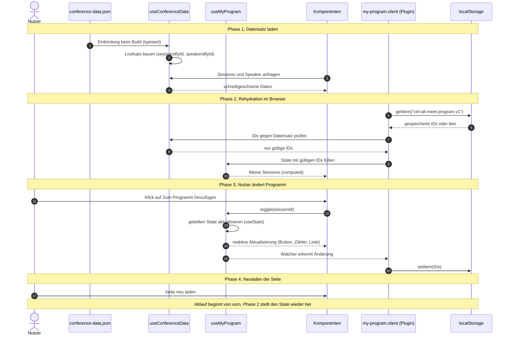

# 03 State Management Konzept

_Wie Ctrl Alt Meet den Konferenzdatensatz lädt und "Mein Programm" verwaltet._

---

## Übersicht

Dieses Dokument beschreibt, wie der geteilte Datensatz `conference-data.json` modelliert wird und wie der persönliche State „Mein Programm“ reaktiv verteilt und im `localStorage` gespeichert wird. Es richtet sich an alle, die Komponenten bauen.

## Kernaussagen

- Der Datensatz ist statisch und wird einmal über `useConferenceData()` bereitgestellt.
- „Mein Programm“ besteht nur aus Session-IDs, vollständige Sessions werden abgeleitet.
- Der State liegt in Nuxt `useState`, ein client only Plugin liest und schreibt ihn im `localStorage`.

## Datensatz laden und modellieren

Die Datei `conference-data.json` wird beim Build eingebunden und mit einem TypeScript Interface beschrieben. `useConferenceData()` stellt Sessions, Speaker, Tracks und Räume schreibgeschützt bereit und baut einmalig Lookups nach ID (z. B. `sessionsById`, `speakersById`). Detailseiten wie `/sessions/[id]` greifen darüber direkt zu, ohne Listen zu durchsuchen. Da der Datensatz sich zur Laufzeit nicht ändert, braucht er keine Synchronisierung.

## State für „Mein Programm“

`useMyProgram()` hält ein Array aus Session-IDs in `useState`. So teilen alle Komponenten dieselbe Instanz, und der State bleibt pro Nutzer getrennt. Das Composable bietet `has(id)`, `toggle(id)`, `count` und `sessions` (computed aus IDs und Datensatz, nach Startzeit sortiert).

Wir speichern nur IDs und keine vollen Objekte. Der Datensatz bleibt die einzige Quelle der Wahrheit, es gibt keine veralteten Kopien, und der gespeicherte Wert ist klein und leicht zu serialisieren. Der Preis ist ein zusätzlicher Lookup, der durch die Maps aus `useConferenceData()` günstig ist.

## Persistenz und Rehydration

Ein client only Plugin übernimmt die Persistenz an einer zentralen Stelle. Es liest den `localStorage` einmalig nach dem Start im Browser, damit Server und Client zunächst dieselbe leere Ausgabe erzeugen. Dabei werden ungültiges JSON abgefangen und IDs entfernt, die im Datensatz nicht mehr existieren. Danach registriert das Plugin genau einen Watcher, der jede Änderung unter dem versionierten Schlüssel `ctrl-alt-meet.program.v1` speichert. Läge der Watcher im Composable, würde jede aufrufende Komponente einen eigenen registrieren. Änderungen in einem zweiten Tab gleicht das Plugin über das `storage` Event ab.

## Reaktive Verteilung

`AddToProgramButton`, `SessionCard`, `AppHeader` (Zähler) und die Seite „Mein Programm“ rufen alle `useMyProgram()` auf. Weil der State geteilt und reaktiv ist, aktualisiert ein Klick alle Stellen gleichzeitig. Ein Store wie Pinia wäre bei diesem Umfang Overhead, `useState` plus Composable genügt.

## Verworfene Alternativen

Volle Session-Objekte im `localStorage` hätten zwar einen Lookup gespart, würden aber veralten, sobald sich der Datensatz ändert. Pinia bietet DevTools und Struktur für große Stores, ist für einen einzelnen Array-State aber eine zusätzliche Abhängigkeit ohne Mehrwert. Ein einfaches `ref` auf Modulebene scheidet in Nuxt aus, weil es serverseitig zwischen Anfragen geteilt würde. `sessionStorage` verwerfen wir, weil das Programm einen Browser-Neustart überleben soll.

## Datenfluss

Phase 1 stellt den Datensatz bereit, Phase 2 stellt beim Neuladen den State aus den gespeicherten IDs wieder her, Phase 3 hält ihn bei jeder Änderung aktuell.

---

_Zuletzt aktualisiert: 2026-10-10_