# 04 – Verifikations-Nachweis

_Wie wir die Offline-Funktionalität getestet haben, was die Ergebnisse zeigen und welche Lücken bleiben._

---

## Übersicht

Dieser Nachweis belegt Installierbarkeit, Service Worker, Manifest und das Offline-Verhalten der App mit Screenshots aus den Chrome-DevTools und einem Lighthouse-Auszug. Die Belege sind den Testszenarien aus dem Entscheidungsprotokoll (Dokument 03) zugeordnet.

## Kernaussagen

- Manifest ist gültig, die App ist installierbar, der Service Worker ist aktiv.
- Alle drei Szenarien aus Dokument 03 sind mit Screenshots belegt.
- Lighthouse hat in Chrome 157 keine PWA-Kategorie mehr, die PWA-Prüfung erfolgt über das Application-Panel.

---

## Installierbarkeit, Manifest und Service Worker

**Manifest.** Application → Manifest zeigt Name, Farben und Icons ohne Fehler.

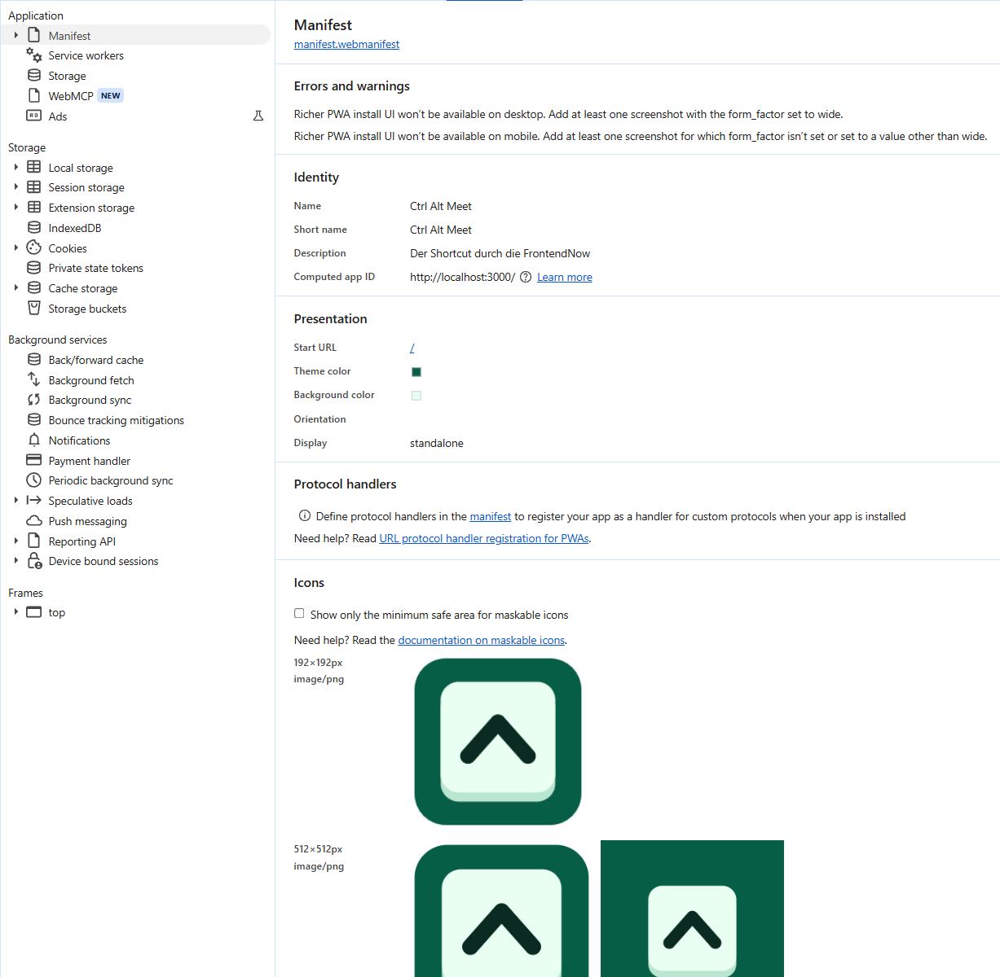

**Installierbarkeit.** Chrome bietet die Installation an, die App öffnet sich im eigenen Fenster.

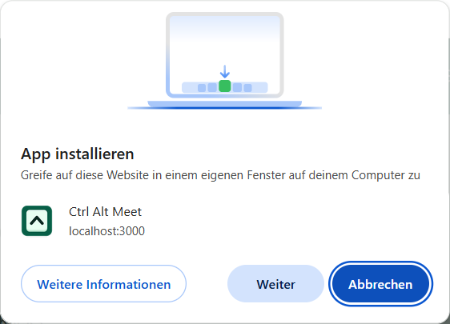

**Service Worker.** Application → Service workers zeigt `sw.js` als „activated and running“.

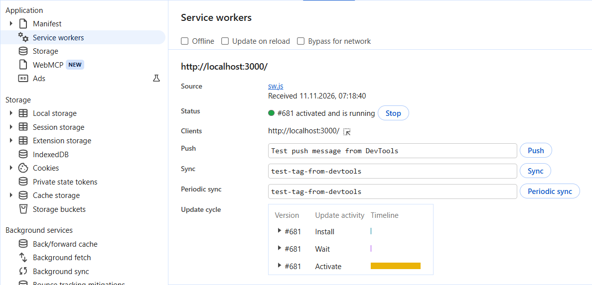

**Precache.** Application → Cache storage enthält 82 vorab gespeicherte Einträge, darunter App-Shell, Startseite, „Mein Programm“ und die Offline-Seite …

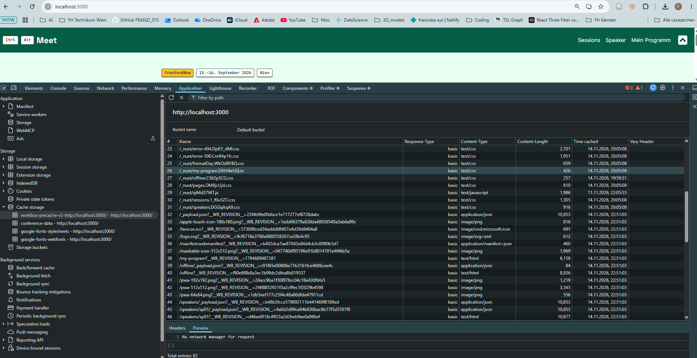

… sowie die Speaker-Liste und alle 18 Speaker-Profile mit ihren Seiten-Daten.

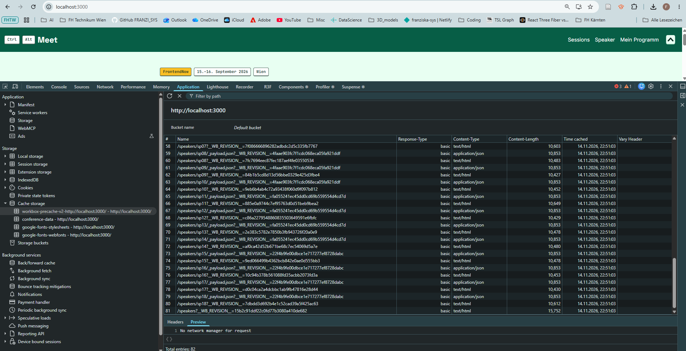

## Szenario i, Session-Übersicht im Flugmodus

Über die Navigation erscheint die Übersicht offline vollständig. Der Service Worker liefert `/api/conference` aus dem Cache („(ServiceWorker)“), die Aktualisierung im Hintergrund schlägt offline fehl.

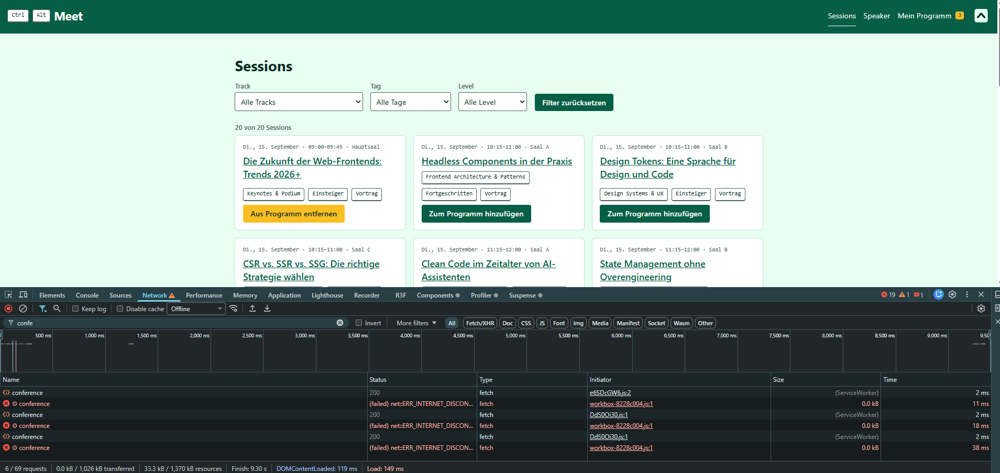

Eine nie besuchte Session, direkt aufgerufen, zeigt die eigene Offline-Seite.

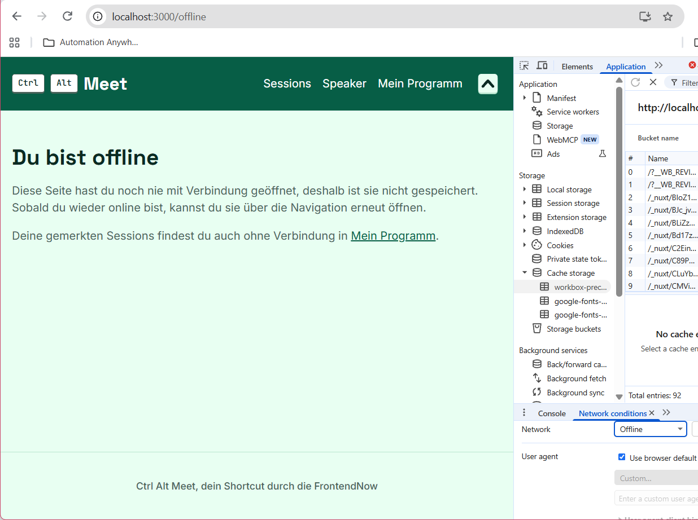

## Szenario ii, „Mein Programm“ offline

Nach dem Besuch der Startseite liegt `conference-data` bereits im Cache.

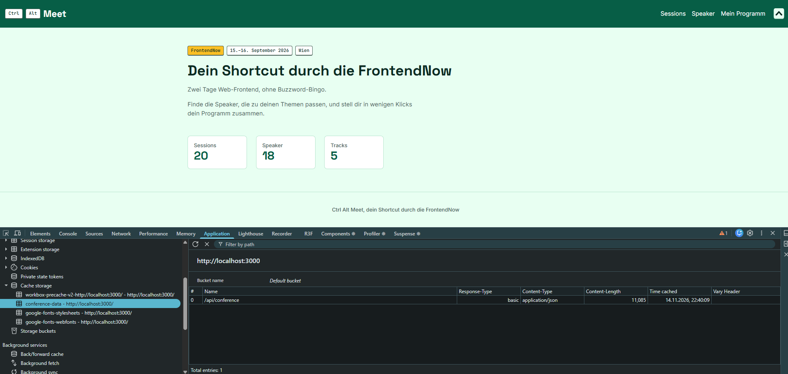

„Mein Programm“ zeigt offline alle drei gemerkten Sessions mit Titel, Zeit und Raum. Der Service Worker liefert die Daten aus dem Cache.

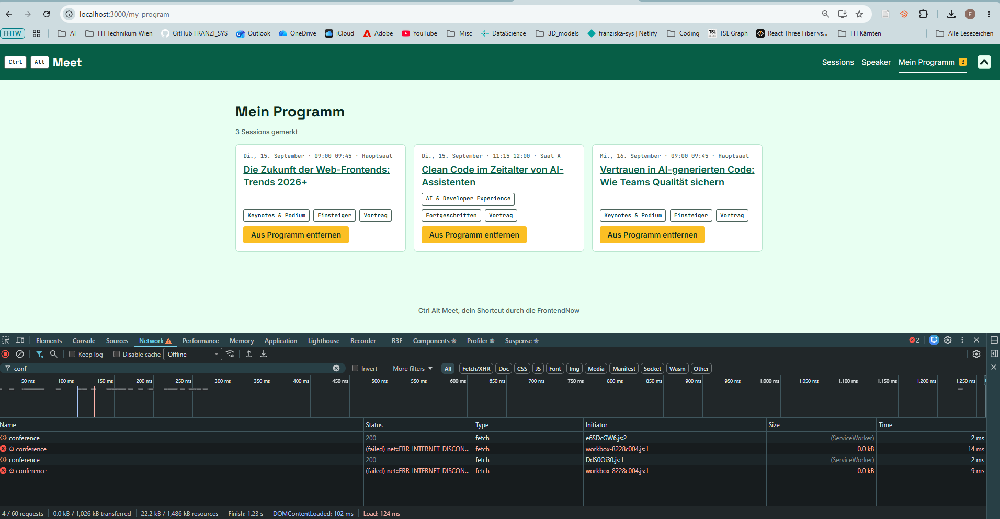

## Szenario iii, Erstbesuch ohne Netz

Im Inkognito-Fenster zeigt der Browser seine eigene Fehlerseite, weil noch kein Service Worker installiert ist.

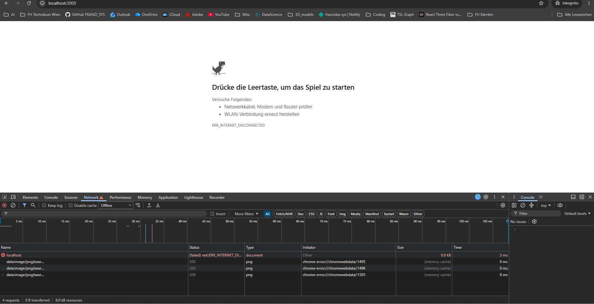

## Startseite offline

Nach einem Online-Besuch lädt die Startseite offline vollständig (Entscheidung 5).

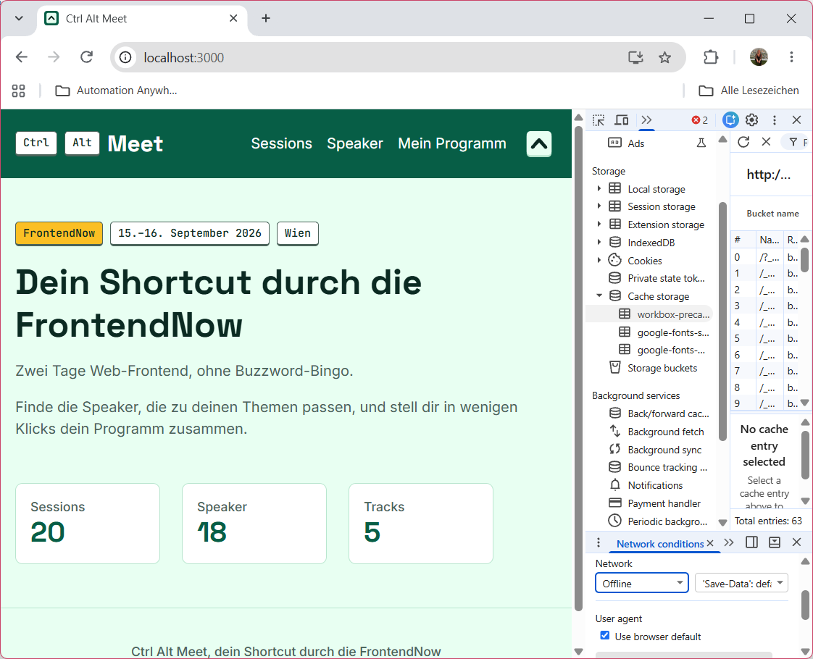

## Lighthouse

Lauf im Modus „Navigation“ auf `localhost:3000`, Gerät Desktop, in einem Inkognito-Fenster ohne Browser-Erweiterungen.

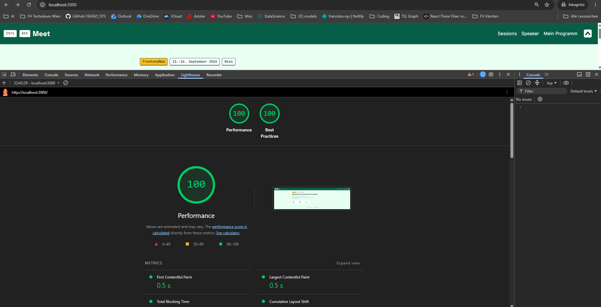

| Kategorie | Ergebnis |
|---|---|
| Performance | 100 |
| Best Practices | 100 |

## Einordnung

Getestet haben wir mit Chrome 157 auf zwei Rechnern, jeweils mit `npm run build` und `npm run preview`. Die Verbindung wurde in den DevTools über Network, Offline getrennt, zurückgesetzt wurde über Application, Clear site data, für den Erstbesuch über ein Inkognito-Fenster. Das Application-Panel belegt die Grundlagen. Das Manifest ist gültig, die App lässt sich installieren, der Service Worker ist aktiv, und der Precache enthält App-Shell, Startseite, alle Speaker-Seiten, „Mein Programm“ und die Offline-Seite. Die Szenarien zeigen, dass die Strategien aus Dokument 02 so greifen wie geplant. Der Network-Tab weist bei `/api/conference` den Service Worker als Quelle aus, die Aktualisierung im Hintergrund scheitert offline wie bei Stale-While-Revalidate vorgesehen. „Mein Programm“ erscheint offline mit vollständigen Daten, auch nach einem Neuladen. Lücken bestehen beim Neuladen der Session-Übersicht, die nur nach einem direkten Aufruf im Cache liegt, bei der Adresse der Offline-Seite und beim Erstbesuch ohne Netz. Lighthouse enthält in Chrome 157 keine eigene PWA-Kategorie mehr. Installierbarkeit, Service Worker und Manifest belegen wir deshalb über das Application-Panel, Lighthouse liefert ergänzend Performance und Best Practices.

---

_Zuletzt aktualisiert: 2026-11-14_